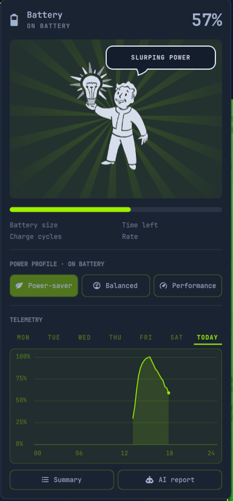

<div align="center">



<br>

# Vault-Tec power — your battery, under watch.

A battery and power-profile panel for the Omarchy bar, in the spirit of the Vault.<br>
Live charge, rate and time left. Seven days of telemetry. One click to an AI battery report.<br>

**Know where your power goes.**<br>
No cloud. No account. The history stays on your disk.

<br>

[](https://omarchy.org)
&nbsp;&nbsp;
[](https://github.com/Anerti/vault-power-plant)
&nbsp;&nbsp;
[](https://quickshell.org)

</div>

---

## Install

Vault-Tec power is a standard Omarchy plugin. One command clones it into `~/.config/omarchy/plugins/anerti.vault-power-plant/` and enables it:

```bash
omarchy plugin add https://github.com/Anerti/vault-power-plant.git --enable
```

Plugins run as unsandboxed code inside `omarchy-shell`. If you would rather read the code first, leave out `--enable`. The plugin then lands disabled, and you enable it once you have reviewed it:

```bash
omarchy plugin enable anerti.vault-power-plant
```

The widget appears in the center of the bar. Move it with `omarchy bar move`.

| Task | Command |
|------|---------|
| Install | `omarchy plugin add https://github.com/Anerti/vault-power-plant.git` |
| Enable | `omarchy plugin enable anerti.vault-power-plant` |
| Update | `omarchy plugin update anerti.vault-power-plant` |
| Remove | `omarchy plugin remove anerti.vault-power-plant` |

<details>
<summary><b>Install by hand, without <code>omarchy plugin</code></b></summary>

<br>

```bash
git clone https://github.com/Anerti/vault-power-plant.git ~/.config/omarchy/plugins/anerti.vault-power-plant
omarchy-shell shell rescanPlugins
omarchy plugin enable anerti.vault-power-plant
```

</details>

### Requirements

- An Omarchy desktop running `omarchy-shell`
- UPower, which Omarchy ships by default
- `power-profiles-daemon` for profile switching, through `omarchy-powerprofiles-list` and `omarchy-powerprofiles-set`
- Optional: an AI agent CLI for the AI report (Claude, Codex, Copilot, Cursor CLI, Gemini, Grok, Hermes, Muse Code, omp, OpenClaw, OpenCode or Pi)

---

## What you get

### Battery at a glance

Charge level, state, time left or time to full, the live power rate, battery size and charge cycles. All of it reads from UPower and `omarchy-battery-status`.

**The rate is never a silent 0 W.** Some batteries expose a `power_now` value that cannot be read. When that happens, the panel falls back to UPower's own rate. When the battery sits at a charge limit, the panel says **Holding** instead of showing a misleading time to full.

### Power profiles, one click away

Power-saver, Balanced and Performance sit side by side. The profile you pick is saved separately for battery and for AC, so the laptop switches back on its own when you plug in or unplug.

### Seven days of telemetry

The charge level is sampled once a minute and kept for seven days. Pick a day from the tabs to see its 24-hour curve. Hover the curve to read the exact level at any moment.

> **Your data stays local.** The history lives in `~/.config/omarchy/vault-power-plant/history.json`. It is written every ten minutes and survives restarts. If the file is ever corrupted, it is set aside and a fresh one is started, never silently overwritten.

### Day summary

**Summary** swaps the chart for the selected day's numbers: time recorded, charge range, time on battery, total drained, average drain per hour, and total charged.

Time on battery counts real discharge only. A plateau at 100% does not count, and neither does the slow self-discharge while plugged in at a charge limit. Sleep and shutdown gaps are left out.

### AI battery report

**AI report** hands seven days of 15-minute averages, the current battery status and the active power profile to your default AI agent. You get back a summary of the week, a per-day table, anything unusual, and the three to five changes that would help your battery most.

The data travels inside the prompt itself. The agent needs no command, file or web access, and it is told not to use any. If no default agent is set, the panel lists the agents it finds installed. The one you pick becomes your default.

### Keyboard first

Every control is reachable without the mouse.

| Key | Action |
|-----|--------|
| `↑` `↓` / `k` `j` | Move between rows: profiles, days, actions, agents |
| `←` `→` / `h` `l` | Move within a row |
| `Enter` / `Space` | Activate the selection |
| `Tab` / `Shift+Tab` | Switch to the next or previous bar panel |
| `Esc` | Close the panel |

### Bar options

Right-click the bar icon to show or hide the battery percentage next to it. The setting is saved with your bar layout.

---

## Development

The logic lives in `Model.js` as plain functions, so you can test it without the shell:

```bash
node Model.test.js
```

Omarchy reloads the plugin as soon as you save any file under `~/.config/omarchy/plugins/`.

| File | Role |
|------|------|
| `Panel.qml` | Bar widget and panel: data sources, keyboard model, layout |
| `BatteryCharts.qml` | Day tabs, 24-hour chart and day summary |
| `PanelArt.qml` | Vault Boy artwork and dialogue bubble |
| `Model.js` | Parsing, telemetry buckets, day stats, AI prompt |
| `Model.test.js` | Assertion tests for `Model.js` |

---

<div align="center">

Built on Omarchy's built-in power widget (`omarchy.power`).<br>
Vault-Tec and Vault Boy are trademarks of Bethesda Softworks. This is an unofficial fan project.

</div>
